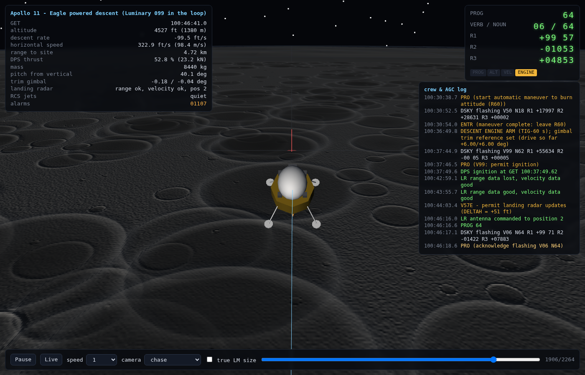
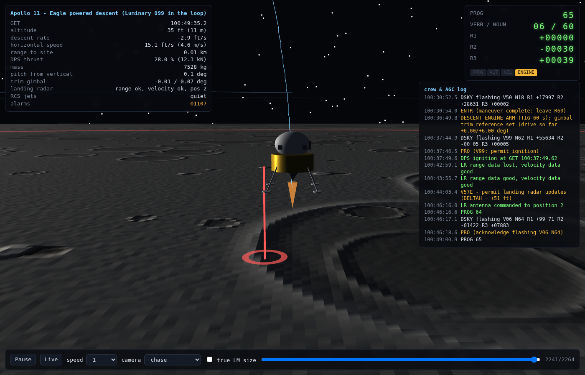
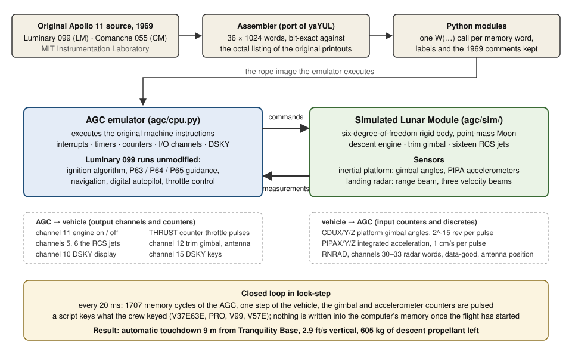

# Apollo 11 Guidance Computer in Python

**The original Apollo 11 flight software flies a lunar landing again.**


https://github.com/user-attachments/assets/3ca810f9-fa6d-4df9-aa34-bb249b017bbe

*Time-lapse, about ten times faster than the flight: the 20 minutes from selecting P63 to touchdown (12 of them under power) in two minutes.  The computer, the display and the log are the real ones.*


Luminary 099, the program that ran in the Lunar Module's computer on
20 July 1969, is assembled from the 1969 listing, executed cycle by cycle
in a Python emulator of the Apollo Guidance Computer (AGC) that is checked
against the reference emulator yaAGC, and connected to a six-degree-of-freedom
simulation of the Lunar Module.  The result: the original software flies a
complete automatic descent from the lunar orbit to a touchdown on
Tranquility Base.

The source is assembly language for a computer that was built for this one
purpose and had functions no other computer ever had.  What runs here is not
the symbolic assembler read as text, but the program assembled from it, word
for word in 15-bit words, exactly as it was woven into the core rope memory
in 1969.

Python provides what the hardware provided: the computer, the vehicle, the
inertial platform, the landing radar, the DSKY keyboard and the pad load.
It does not compute the trajectory and it does not decide how to land.  The
ignition time, the attitude manoeuvre, the throttle, the attitude-control
jets, the navigation with the landing radar and the switch from the braking
to the approach to the landing phase are decided by the words of the 1969
program, with its own fixed-point arithmetic, executive, interrupts and
interpreter.  None of the Apollo guidance algorithms has been rewritten in
Python.

The flight software is not modified.  The GitHub transcription of the
listing contains a few typing errors; they are corrected on reading so that
the assembly matches the octal listing of the original printouts word for
word (see [Verification](#verification)).  The simulation deliberately
differs from the historical flight: the sensors are ideal, there is no
terrain, and the automatic landing program P65 flies to the surface where
Armstrong took over manually with P66.



*Simulated Apollo 11 landing with the original source code from 1969.*

```
contact at GET 100:49:47: vertical -2.9 ft/s, horizontal 0.2 ft/s,
9 m from the target, tilt 0.6 deg, DPS propellant left 605 kg
```

Speeds are relative to the lunar surface, which itself moves at 4.6 m/s in
the inertial frame at the site.

## Contents

- [What is genuine and what is simulated](#what-is-genuine-and-what-is-simulated)
- [Verification](#verification)
- [Quick start](#quick-start)
- [The landing simulation](#the-landing-simulation)
- [The 3D viewer](#the-3d-viewer)
- [How the AGC runs in Python](#how-the-agc-runs-in-python)
- [Test UI](#test-ui)
- [Limitations and ideas](#limitations-and-ideas)
- [The people who wrote this](#the-people-who-wrote-this)
- [Credits and license](#credits-and-license)
- [Technical details](docs/TECHNICAL.md): a module of the original listing next to its Python form, the interpretive language, the emulator, the hardware interface, all options and physics of the simulation, the project layout

## What is genuine and what is simulated

**Genuine**

- The flight software.  Luminary 099 assembles to the same 36 × 1024 words as
  the octal listing reconstructed from the original printouts by the Virtual
  AGC project, checksums ("bugger words") included.  The Python modules are
  generated from that rope.  The emulator runs with hardware alarm checking
  enabled, so a real restart would occur if the software tripped one.
- The pad load.  The erasable constants are the Apollo 11 values from the
  Grumman LM Data Book: guidance targets, landing site, landing radar
  weights, DAP gains, ignition algorithm parameters, time of landing.
- The crew procedures.  A script keys exactly what the crew keyed: `V37E63E`,
  `PRO` on the ignition-algorithm display, the R60 attitude manoeuvre, `V99`
  ignition enable, declining the optional fine alignment, and `V57E` to let
  the computer use the landing radar once ΔH is plausible.
- The landing site.  The simulation does not know where Tranquility Base is;
  it lets Luminary compute the inertial site vector and the lunar rotation
  axis from its own ephemeris routines and uses those.  The target the
  vehicle is measured against at touchdown comes out of the 1969 program,
  not out of the simulation.

**Simulated**

- The vehicle: a rigid body with the descent engine (throttle counter,
  12.53 N per pulse, 0.2 s lag, 43.9 kN fixed throttle position), the trim
  gimbal, the sixteen RCS jets (445 N each, driven by channels 5 and 6), mass
  and inertia.
- The sensors: an ideal inertial platform (gimbal CDU counters, PIPA
  accelerometer pulses of 1 cm/s) and a geometric landing radar (two antenna
  positions, range beam, three velocity beams, data-good discretes).  No
  noise, no bias.
- The world: a point-mass Moon.  The AGC's own navigation uses the lunar
  J2/C22 terms from its pad load, so the two disagree by about 2 ft/s before
  the landing radar takes over, which is realistic.
- One deliberate deviation in the pad load: the fifteen IMU compensation
  constants (accelerometer bias and scale factor, gyro drifts) are zeroed,
  because the simulated IMU has no errors to compensate.

**Not modelled**

- The rendezvous radar, whose switch setting caused the famous 1201/1202
  executive overflow alarms.  The simulation therefore produces no overload
  and no restarts.
- The abort guidance system, the manual rate-of-descent mode P66 that
  Armstrong used, and the terrain.  Here the automatic landing program P65
  flies to touchdown, which no Apollo commander ever let it do.

## Verification

Three different claims, three different kinds of evidence.

| Claim | Evidence |
|-------|----------|
| **The program is the original.** | Both programs assemble bit-exactly against the octal listings reconstructed from the original printouts (`Luminary099.binsource`, `Comanche055.binsource` from Virtual AGC): zero differing words in 36 × 1024, bank checksums included.  That comparison exposed transcription errors in the GitHub copy of the source that change the code (a `1.08-2` for `1.0B-2`, a misspelled label and a misspelled operand, a comment line without `#`, pseudo-labels `+2` after a tab).  They are documented in `agc/asm/fixups.py` and corrected on reading; Luminary needed no word-changing fix.  The Comanche findings went back upstream as [chrislgarry/Apollo-11#1007](https://github.com/chrislgarry/Apollo-11/pull/1007) (the four typos, each checked against the scanned printout) and [#1008](https://github.com/chrislgarry/Apollo-11/pull/1008) (115 location labels that a tab had moved into the opcode column); with both, the GitHub copy assembles with yaYUL to the flight binary. |
| **The emulator executes it correctly.** | The CPU is a cycle-level model written after yaAGC, and it is checked against yaAGC cycle by cycle: `tools/diff_trace.sh` runs both emulators through the same 126 s scenario (fresh start, the 90 s IMU turn-on sequence, the lamp test, the mission clock, a refused and an accepted `V37E00E`, alarm display, `RSET`) and compares the registers Z, A, L, Q, EB, FB, BB, the interrupt state and the extracode flag after every one of the 10.75 million memory cycles.  They are identical.  Not covered by that scenario: the counter inputs of the flight (CDU, PIPA, radar), which are verified by the landing itself. |
| **The landing is plausible.** | Touchdown 9 m from the AGC's own target at 2.9 ft/s vertical, 11 min 58 s after ignition (Apollo 11: 12 min 35 s), 605 kg of descent propellant left; the AGC's navigation agrees with the simulated truth to 2 ft/s before radar acquisition.  The run is reproducible from the repository.  It shows that Luminary's guidance, navigation and control are internally consistent; it proves nothing about the real sensors, vehicle or terrain (see [Limitations](#limitations-and-ideas)). |

`python3 -m pytest` runs 31 tests: assembler bit-exactness, CPU arithmetic,
boot and DSKY, 600 000 cycles against yaAGC (skipped without `gcc` and the
Virtual AGC sources), emulator state save/restore, fixed-point scaling, pad
load integrity, gimbal maths, ballistic-impact detection and the viewer's
port selection.

## Quick start

Python 3.10 or newer; the AGC port needs only the standard library, the
landing simulation needs `numpy`, the 3D viewer loads three.js from a CDN
and therefore needs an internet connection.

```bash
git clone https://github.com/jweigend/Apollo11.git
cd Apollo11
./start.sh help          # Linux / macOS: the launcher creates .venv, installs numpy and pytest, starts things
start.bat help           # Windows (same commands: land, view, run, tui, test, ...)
./start.sh land --view --realtime
```

Or by hand, without the launcher:

```bash
python3 -m venv .venv && .venv/bin/pip install numpy pytest
source .venv/bin/activate

python3 -m agc.sim land                      # fly the landing (about 13 minutes)
python3 -m agc.sim land --view --realtime    # fly it in real time and watch in the browser
python3 -m agc.sim view landing.csv          # replay a recorded flight

python3 -m agc run luminary099 --keys V16N36E   # boot the computer, show the mission clock
python3 -m agc tui luminary099                  # interactive test UI
python3 -m pytest
tools/diff_trace.sh                             # the emulator against yaAGC, cycle by cycle (needs gcc and the clones below)
```

All options, the physics, how to regenerate the Python modules from the
listings and the clones the differential test needs are in
[docs/TECHNICAL.md](docs/TECHNICAL.md#7-running-the-landing-simulation).

## The landing simulation

`python3 -m agc.sim land` starts eight minutes before powered descent
initiation in the 60 × 8 nautical mile descent orbit, with the real time of
landing from the pad load.  The first run also gives the computer its fresh
start with the 90 s IMU turn-on sequence of the flight software (some 40 s
of computing, shown as `[setup]` lines, cached for later runs).  Then the
crew script keys `V37E63E` and the events of the flight appear:

```
100:30:14.2  crew: V37E63E - select P63 braking phase
100:30:30.9  AGC computed TIG = 100:37:49.61 (in 438.7 s)
100:30:33.5  crew: PRO  (P63 ignition algorithm done: accept N61)
100:30:38.7  crew: PRO  (start automatic maneuver to burn attitude (R60))
100:36:49.8  crew: DESCENT ENGINE ARM (TIG-60 s)
100:37:46.5  crew: PRO  (V99: permit ignition)
100:37:49.6  DPS ignition at GET 100:37:49.62
100:43:55.7  LR range data good, velocity data good
100:44:03.4  crew: V57E - permit landing radar updates (DELTAH = +51 ft)
100:46:16.0  LR antenna commanded to position 2
100:46:16.6  PROG 64
100:49:00.9  PROG 65
100:49:47.5  *** CONTACT - engine stop ***
100:49:47.5  contact at GET 100:49:47.46: vertical -2.9 ft/s, horizontal 0.2 ft/s,
             9 m from the target, tilt 0.6 deg, DPS propellant left 605 kg
```

Everything after the keystrokes is Luminary: the ignition time comes out of
its ignition algorithm, the 26 s at 10 % throttle and the throttle-up are
its own, the braking phase P63 ends at high gate where it commands the
landing radar antenna to position 2 and switches to P64, and 12 s before the
approach target it switches to the automatic landing phase P65, which nulls
the horizontal velocity and descends at 3 ft/s until the probes touch.

Telemetry goes to `landing.csv`, the events to `landing.events.csv`;
`python3 -m agc.sim report landing.csv` summarises a run with ASCII plots.

## The 3D viewer

`python3 -m agc.sim view landing.csv` serves a page on `http://127.0.0.1:8765/`
(three.js from a CDN, everything else inline).  It shows the Moon with
procedural craters under a low morning sun from the east, the landing site
and the ground track, the flown trajectory, the Lunar Module with its
simulated attitude, the descent engine plume and the firing RCS jets, a
head-up display and a DSKY.  The crew and AGC log scrolls on the right and
new entries are announced during playback.  Playback, scrubbing, speed,
camera (chase, side, landing site, free orbit) and true-scale LM size are in
the control bar.  Started with `land --view`, the page follows the running
simulation live.



If Python runs in a container or on a remote machine, forward the port your
IDE reports and open the URL it offers; the viewer must keep running while
the page is open.

## How the AGC runs in Python



The flight software talks to the vehicle only through counters and I/O
channels, and the simulation provides exactly those.  Every 20 ms the
emulator executes 1707 memory cycles, the vehicle moves, the platform
gimbals follow the attitude, the accelerometers emit their pulses, the
radar beams are intersected with the lunar sphere.  Nothing is written into
the computer's memory once the flight has started.  A worked example with
real excerpts of the 1969 listing, the generated Python module, the
interpretive guidance language, the emulator and the full table of the
hardware interface is in [docs/TECHNICAL.md](docs/TECHNICAL.md).

Each `.agc` file of the listing becomes a Python module that follows it
line by line.  The programmers' comments survive as Python comments, every
memory word is a `W(...)` call and every symbol definition an `S(...)` call:

```python
# TO ENTER A JOB REQUEST REQUIRING NO VAC AREA:
W('5072', 0o00004, 'NOVAC', 'INHINT', line=37)
W('5073', 0o65164, '', 'AD', 'FAKEPRET', 'LOC(MPAC +6) - LOC(QPRET)', line=38)
W('5074', 0o54063, '', 'TS', 'NEWPRIO', 'PRIORITY OF NEW JOB + NOVAC C(FIXLOC)', line=39)
```

`W(address, word, label, opcode, operand, comment)`: addresses in listing
style (`'5072'` fixed-fixed, `'32,2776'` bank 32 offset 2776), the word is
the assembled 15-bit value.  Interpreter instructions and their operands are
marked `kind='interp'` and `kind='operand'`, constants `kind='data'`.
`agc.program.Program` builds the rope memory from the modules and offers
symbol lookups:

```python
from agc.program import load_program
from agc.cpu import AGC, CYCLES_PER_SECOND
from agc.dsky import DSKY

prog = load_program("luminary099")
cpu = AGC(prog.fixed)
dsky = DSKY(cpu)
cpu.run(3 * CYCLES_PER_SECOND)        # 3 seconds of AGC time
dsky.type_sequence("V16N36E")         # show the clock
cpu.run(2 * CYCLES_PER_SECOND)
print("\n".join(dsky.render()))
print(prog.symbol("P63LM").fixed_location())      # (26, 510) = bank 32, offset 776
```

**Why an emulator rather than a translation into Python functions?**  The
AGC code is largely data-driven: `INDEX` modifies the following instruction
at run time, jump tables are constants in memory, and much of the flight
software is written in the interpretive language (`VLOAD`, `DLOAD`,
`STORE`, …) that the `INTERPRETER` module reads as data.  A readable
one-to-one translation into Python control flow would be neither correct
nor testable.  So the modules hold the software bit for bit plus all
symbols and comments, and a small CPU in Python executes it with exactly the
arithmetic of the original: ones' complement, the 16-bit accumulator with
overflow, the editing registers, timers, interrupts, counters and I/O
channels.  Routines can be watched symbolically, stopped at breakpoints and
driven through the real DSKY protocol.

## Test UI

`python3 -m agc tui luminary099`

- Type DSKY keys directly: digits, `+`, `-`, `v` VERB, `n` NOUN, `e` ENTR,
  `c` CLR, `r` RSET, `k` KEY REL, `p` PRO.
- `SPACE` run/pause, `s` one instruction, `S` 100 instructions, `[` / `]`
  slower/faster, `q` quit.
- `TAB` cycles module list, routines of the module and watch list; `ENTER`
  shows a routine in the code window, `b` sets a breakpoint there.
- `:` commands: `:w SYMBOL` watch an erasable, `:b LABEL`, `:g LABEL`,
  `:keys V16N36E`, `:run 5`, `:poke SYMBOL 12345`, `:reset`, `:help`.

## Limitations and ideas

The automatic landing shows that Luminary's guidance, navigation and
control are internally consistent and capable of a soft landing from the
descent orbit in a consistent physical world.  It does not show what would
have happened on 20 July 1969 without Armstrong: the real navigation was
off by several kilometres at radar acquisition (ΔH was −2900 ft, here it is
+51 ft), the rendezvous radar load triggered restarts, and the automatic
target lay in a boulder field.  Things that would bring the simulation
closer to the historical flight, all feasible with the current structure:

- an initial state-vector error matching the real ΔH,
- sensor noise and the real IMU errors to go with the pad-load compensation,
- a digital terrain model of the landing zone,
- the rendezvous radar interrupt load to provoke the 1201/1202 alarms,
- a scripted P66 for comparison with the manual landing,
- Comanche 055 in the loop for the rendezvous programs.

## The people who wrote this

This project exists out of admiration.  Running the code makes tangible
what the MIT Instrumentation Laboratory team achieved between 1961 and 1969,
and it deserves saying plainly.

- **The machine.**  2048 words of erasable memory, 36 864 words of fixed
  memory woven by hand into core rope, 15-bit words, about 85 000 memory
  cycles per second, 55 watts, 32 kilograms.  A single wrong word in the
  rope could not be changed after manufacture.  Luminary shares its 2 KB
  of erasable memory between programs through overlays; the same cell is
  `R1S` in the landing and something else in orbit, and nothing ever
  collides.
- **The architecture.**  A priority-driven executive, a waitlist of timed
  tasks, interrupts for counters, radar and the DSKY, an embedded
  interpreter for vector and double-precision arithmetic with a push-down
  list, and a restart system that survived the 1201 and 1202 alarms on 20
  July 1969 without losing the state of the descent.  Much of this became
  common in embedded systems decades later; some of it still is not.
- **The mathematics.**  Everything is fixed point, with a scaling such as
  2^24 metres or 2^7 metres per centisecond that the programmer carried in
  their head for every variable.  Reading the scaling of a dozen variables
  took us hours; they controlled a lunar landing with it.
- **The discipline.**  Checksums at the end of every bank, verification
  listings, a hardware simulator the crews trained on, configuration
  control across releases from Sunburst to Luminary.  This was software
  engineering with review, test and release management, under schedule
  pressure, before the term existed.

Margaret Hamilton led the software effort; Don Eyles wrote the lunar
landing programs; Allan Klumpp designed the landing guidance equations
quoted above; Hal Laning and Charles Muntz created the executive and the
interpreter.  Behind them were hundreds of engineers, programmers and the
workers who wove the ropes.  Executing their words on a modern computer and
watching them bring the vehicle down at 3 ft/s is the best tribute we could
think of.

## Credits and license

The AGC source listings are the work of the MIT Instrumentation Laboratory
(1969), transcribed by Ron Burkey and the Virtual AGC project and mirrored
in `chrislgarry/Apollo-11`.  The assembler and emulator logic follow
`yaYUL` and `yaAGC` from Virtual AGC (GPL v2 or later); this port is
therefore released under the GNU General Public License, version 2 or
later (see `LICENSE`).  Pad-load values come from the Apollo 11 LM Data
Book and the Luminary 1A erasable memory listing.
